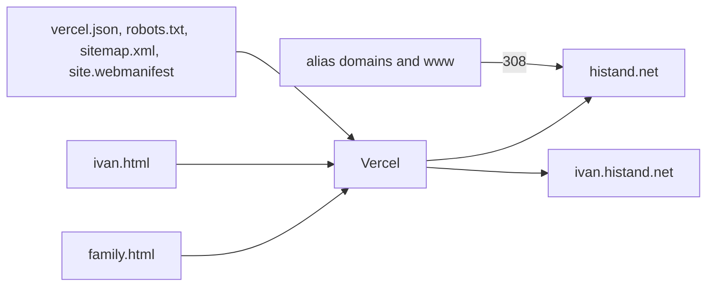

<!-- Format: references/prd-format.md, "prd.md sections". -->
<!-- The first approval goes through the prd-toolkit:authoring-prds skill (phase 7 gates); every later change and approval goes through prd-toolkit:changing-prds (step 5). -->

# histand-net

## 1. Metadata & stack

- Language: HTML, each page with its CSS in a `<style>` element of its own head
- Framework: none; plain static files, no build step on the host
- Database: none
- Hosting: Vercel, project `histand-net`; pushes to `main` deploy to production (README.md)
- Repository: `github.com/ihistand/histand-net`
- Packaging: nothing is packaged or installed. The site is its committed files, deployed as they are. It has no build backend, no entry point and no install command; the two scripts under `scripts/` that make the icons and share images are area `scripts`, not adopted.
- Not used: a static-site generator or front-end framework, a build step on the host, and client-side JavaScript [ASSUMPTION A-01: confirmed by the owner 2026-11-16: the README says "Plain HTML, no build step", and the only `<script>` element of each page is a `type="application/ld+json"` data block, which runs nothing]
- Not applicable: `contracts/openapi.yaml` — the site serves static files and has no API
- Not applicable: `contracts/schema.sql` — the site has no database
- Not applicable: `contracts/events.md` — the site has no events or jobs
- Not applicable: `contracts/permissions.yaml` — every page is public and the site has no roles
- Not applicable: `contracts/config.yaml` — the site reads no settings or feature flags
- Not applicable: `contracts/data-classification.yaml` — the site stores no data
- Not applicable: `contracts/dependencies/` — the site calls no external service
- Not applicable: `contracts/fixtures/` — tests read the committed pages and configuration, not test data

## 2. Summary & goals

histand.net is a static site of two pages: a page about the Histand family name at `https://histand.net/`, and Ivan Histand's name card at `https://ivan.histand.net/`. It is plain HTML served by Vercel with no build step, and eight alias domains, each with its `www`, redirect to `https://histand.net/`.

Goals:

- Serve the family page at `https://histand.net/` and the name card at `https://ivan.histand.net/`, each at the root of its own host (FR-001, FR-002). [ASSUMPTION A-02: confirmed by the owner 2026-11-16: read from the rewrites of `vercel.json` and each page's canonical address]
- Send every request on an alias domain, or on `www.histand.net`, to `https://histand.net/` with its path kept, in one permanent redirect (FR-006). [ASSUMPTION A-02: confirmed by the owner 2026-11-16: read from the redirects of `vercel.json` and the README's Domains section]

Personas: people looking up the Histand family name in Doylestown and Bucks County; people looking for the software Ivan Histand builds and how to reach him. [ASSUMPTION A-03: confirmed by the owner 2026-11-16: read from each page's `description` meta element]

Out of scope:

- Collecting anything from a visitor: no analytics, no forms, no sign-up and no accounts. [ASSUMPTION A-04: confirmed by the owner 2026-11-16: no page holds a form or a script that runs, and the site stores no data]
- The icons, the share images and the scripts that make them: areas `icons`, `images` and `scripts`, not adopted (adoption.md). [ASSUMPTION A-04: confirmed by the owner 2026-11-16: read from adoption.md]
- A custom 404 page: a path the site does not serve gets Vercel's default 404 page. [ASSUMPTION A-12: confirmed by the owner 2026-11-17: on 2026-11-16 production answered `HTTP/2 404` with `content-type: text/plain; charset=utf-8` and `server: Vercel` for `https://histand.net/no-such-page` and `https://ivan.histand.net/no-such-page`, the repository holds no `404.html`, and the owner gave this answer for the first site of this kind, prdanvil.com]

## 3. Glossary

| Term | Meaning | Banned synonyms |
|---|---|---|
| page | One HTML file the site serves at one URL on one host, listed in `contracts/pages.yaml` | none |
| family page | The page `family.html`, served at `https://histand.net/`; `pages:family` in `contracts/pages.yaml` | family-name page |
| name card | The page `ivan.html`, served at `https://ivan.histand.net/`; `pages:ivan` in `contracts/pages.yaml` | none |
| apex | The bare domain `histand.net`, without `www` or another subdomain | none |
| alias domain | A domain the site answers on only to redirect to the apex: `histand.com`, `histand.org`, `histands.com`, `histands.net`, `histands.org`, `anilak.net`, `hinault.net`, `ivanivan.net` | none |
| clean URL | A URL without the `.html` suffix, `/family` for `family.html` | none |
| hosting rule | One rule of how the host serves the site, listed in `contracts/hosting.yaml` | none |
| rewrite | A hosting rule that serves another path's page at a URL, with no redirect | none |

## 4. Architecture

Both pages are written by hand. Vercel serves the repository's committed files as they are, with
the rules in `vercel.json`: `/` on `ivan.histand.net` serves `ivan.html`, `/` on every other host
serves `family.html`, and the alias domains and `www.histand.net` redirect to the apex. The
icons, the share images and the scripts that make them are other areas (adoption.md).

## 5. Standards registry

Not applicable: the repository configures no linter.

## 6. Skills registry

| Object or activity | Skill | Decision |
|---|---|---|
| plans | superpowers:writing-plans | recommended |
| reviewing a change before merge | code-review | recommended |
| checking a change works before calling it done | superpowers:verification-before-completion | recommended |
| work on the pages' HTML and CSS | frontend-design:frontend-design | recommended |

Decisions: `recommended` for each row, none `required`: the owner decided the four rows on 2026-11-16, the same four, with the same decision, as on the first site of this kind, prdanvil.com. `code-review` is built into Claude Code and can only be `recommended`.

## 7. Contract types

| Type | Files (glob) | Validator |
|---|---|---|
| errors | `contracts/errors.yaml` | built-in |
| pages | `contracts/pages.yaml` | `uv run --quiet --script ../../../scripts/prd/validate_pages.py` |
| hosting | `contracts/hosting.yaml` | `uv run --quiet --script ../../../scripts/prd/validate_hosting.py` |

`pages` and `hosting` are custom types. Each validator is a script in this repository's
`scripts/prd/`, run by lint from this PRD folder with the type's files appended; it reads only those
files and the repository that holds them, and names nothing of this site. Both scripts are byte for
byte those of the first site of this kind, prdanvil.com, so that a pack can be written from what
the two PRDs share. The shape of each type is in its script's docstring:

- `pages`: one top-level key per page, with `url`, `file`, `title`, `canonical`, and optionally
  `host` (the host the page is served on at `url`), `source` and `generator` (a generated page),
  `links` and `holds`. A test case targets a page as `pages:<name>`.
- `hosting`: one top-level key per hosting rule, with `rule` (`clean-urls`, `redirect`, `rewrite`,
  `not-deployed` or `crawl`), `config` (the file the rule is set in) and the rule's own keys. A test
  case targets a rule as `hosting:<name>`.

## 8. Adoption map

See adoption.md.

## 9. Versioning

- Breaking for the site: a URL of `contracts/pages.yaml` that stops answering 200 on its host, or a rule of `contracts/hosting.yaml` that is removed or changed, is breaking and takes a major bump. [ASSUMPTION A-05: confirmed by the owner 2026-11-16: the pages and hosting rules are what the site promises to its readers and to search engines]
- Compatibility window: an old URL keeps working, as a permanent redirect, with no end date. [ASSUMPTION A-06: confirmed by the owner 2026-11-16: every redirect in `vercel.json` is permanent]
- Migration rule: a moved page gets a permanent redirect from its old URL to its new one in `vercel.json`; a removed page gets one to `/`. [ASSUMPTION A-07: confirmed by the owner 2026-11-16: the form of the `/family` and `/ivan` redirects of `vercel.json`, written when the name card moved to ivan.histand.net (commit d7cfb18)]

## 10. Design & UI

The site's pages are listed in `contracts/pages.yaml` and their requirements are in
`features/site.md`. Each page carries its own look in a `<style>` element of its head, light and
dark through `prefers-color-scheme`. The icons and the share images are areas `icons` and
`images`, not adopted.

## 11. Requirement index

| ID | Title | Status | File | Since |
|---|---|---|---|---|
| UJ-01 | A reader looks up the Histand family name | live | features/site.md | 1.0.0 |
| UJ-02 | A visitor finds the software Ivan Histand builds and how to reach him | live | features/site.md | 1.0.0 |
| FR-001 | Serve the family page at the root of histand.net | approved | features/site.md |  |
| FR-002 | Serve the name card at the root of ivan.histand.net | approved | features/site.md |  |
| FR-003 | Serve pages at clean URLs | approved | features/site.md |  |
| FR-004 | Redirect /family to the root | live | features/site.md | 1.0.0 |
| FR-005 | Redirect /ivan to the root of ivan.histand.net | approved | features/site.md |  |
| FR-006 | Redirect www.histand.net and every alias domain to the apex | live | features/site.md | 1.0.0 |
| FR-007 | Let every crawler crawl the site and name the sitemap | live | features/site.md | 1.0.0 |
| FR-008 | List both pages in the sitemap | live | features/site.md | 1.0.0 |
| FR-009 | Publish a web app manifest | live | features/site.md | 1.0.0 |
| FR-010 | Keep local state out of the repository, and files that are not the site off the deploy | approved | features/site.md |  |
| FR-011 | Identify the family page in its head | live | features/site.md | 1.0.0 |
| FR-012 | Give the family page its own share card | live | features/site.md | 1.0.0 |
| FR-013 | Describe the family page as a schema.org WebPage | live | features/site.md | 1.0.0 |
| FR-014 | Show the family history, its sources and a link to the name card | live | features/site.md | 1.0.0 |
| FR-015 | Identify the name card in its head | live | features/site.md | 1.0.0 |
| FR-016 | Give the name card its share card | live | features/site.md | 1.0.0 |
| FR-017 | Describe the name card's subject as a schema.org Person | approved | features/site.md |  |
| FR-018 | Show projects, work, the family page and contact links on the name card | live | features/site.md | 1.0.0 |
| FR-019 | Link the favicon, touch icon and manifest from both pages | live | features/site.md | 1.0.0 |
| FR-020 | Load nothing from another host and run no script | live | features/site.md | 1.0.0 |
| FR-021 | Follow the reader's light or dark scheme | live | features/site.md | 1.0.0 |
| FR-022 | Animate the background wash, and stop it under reduced motion | live | features/site.md | 1.0.0 |

## 12. Assumptions index

| ID | Assumption | Status |
|---|---|---|
| A-01 | no static-site generator, front-end framework, host build step or client-side JavaScript (§1 Not used) | confirmed |
| A-02 | the two goals of §2 | confirmed |
| A-03 | the personas of §2 | confirmed |
| A-04 | the two Out of scope items of §2 (visitor data; areas `icons`, `images`, `scripts`) | confirmed |
| A-05 | what is breaking for the site (§9) | confirmed |
| A-06 | an old URL keeps working as a permanent redirect with no end date (§9) | confirmed |
| A-07 | a moved page redirects permanently to its new URL, a removed one to `/` (§9) | confirmed |
| A-08 | the human Check of runbook step 1 (operations.md) | confirmed |
| A-09 | the site has no non-functional requirement of its own (nfr.md) | confirmed |
| A-10 | the user journey UJ-01, a reader looks up the Histand family name | confirmed |
| A-11 | the user journey UJ-02, a visitor finds the software Ivan Histand builds and how to reach him | confirmed |
| A-12 | a path the site does not serve gets Vercel's default 404 page, and a custom 404 page is out of scope (§2) | confirmed |

## 13. Open questions

None.

## 14. Changelog

| Version | Date | Change | IDs |
|---|---|---|---|
| 0.1.0 | 2026-11-16 | Draft started | none |
| 1.0.0 | 2026-11-17 | Approved; site area adopted; suite T-001.1 pass, T-001.2 pass, T-001.3 known-failing E-005, T-002.1 pass, T-002.2 pass, T-002.3 known-failing E-005, T-003.1 pass, T-003.2 pass, T-004.1 pass, T-004.2 pass, T-004.3 pass, T-005.1 pass, T-005.2 pass, T-005.3 known-failing E-001, T-006.1 pass, T-006.2 pass, T-006.3 pass, T-007.1 pass, T-007.2 pass, T-008.1 pass, T-008.2 pass, T-009.1 pass, T-009.2 pass, T-010.1 pass, T-010.2 known-failing E-006, T-010.3 known-failing E-006, T-011.1 pass, T-012.1 pass, T-012.2 pass, T-013.1 pass, T-014.1 pass, T-014.2 pass, T-014.3 pass, T-015.1 pass, T-016.1 pass, T-016.2 pass, T-017.1 pass, T-017.2 pass, T-017.3 known-failing E-004, T-017.4 known-failing E-004, T-018.1 pass, T-018.2 pass, T-018.3 pass, T-018.4 pass, T-018.5 pass, T-019.1 pass, T-019.2 pass, T-019.3 pass, T-020.1 pass, T-020.2 pass, T-020.3 pass, T-020.4 pass, T-021.1 pass, T-021.2 pass, T-022.1 pass, T-022.2 pass, T-022.3 pass, T-022.4 pass; dry run T-002.2, T-020.1, T-010.2, T-011.1, T-005.3, 0 open questions | UJ-01, UJ-02, FR-001, FR-002, FR-003, FR-004, FR-005, FR-006, FR-007, FR-008, FR-009, FR-010, FR-011, FR-012, FR-013, FR-014, FR-015, FR-016, FR-017, FR-018, FR-019, FR-020, FR-021, FR-022 |
